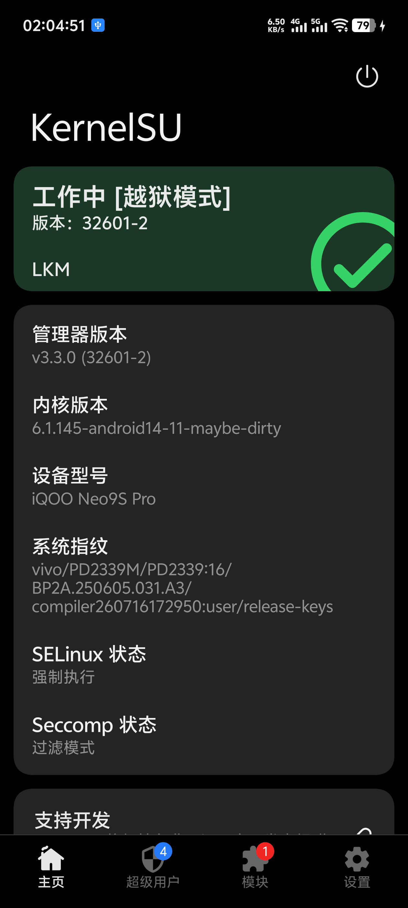
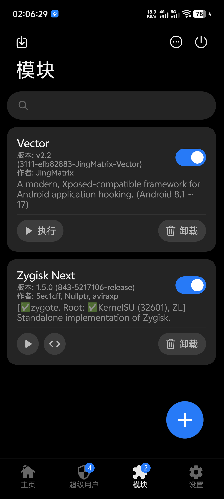

# 文档索引

| 文件 | 内容 |
|---|---|
| [01-manager-freeze-rootcause.md](01-manager-freeze-rootcause.md) | **本代核心**：管理器卡死 / 看门狗复位的根因定位（两处握手 + seccomp）与修复 |
| [02-modules-and-softreboot-fix.md](02-modules-and-softreboot-fix.md) | 模块安装失败 / 软重启无反应的根因与 ksud 启动器方案 |
| [03-kernel-module-build.md](03-kernel-module-build.md) | 内核模块构建记录：vermagic、MODVERSIONS CRC、`struct module` = 0x440 |
| [04-manager-selection-experiment.md](04-manager-selection-experiment.md) | 三家管理器（官方 KernelSU / SukiSU-Ultra / KernelSU-Next）实测对比 |

## 截图

| | |
|---|---|
|  |  |
| 管理器首页：工作中 [越狱模式]，LKM | 模块页：Vector / Zygisk Next 可正常执行与卸载 |
